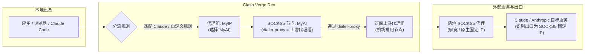
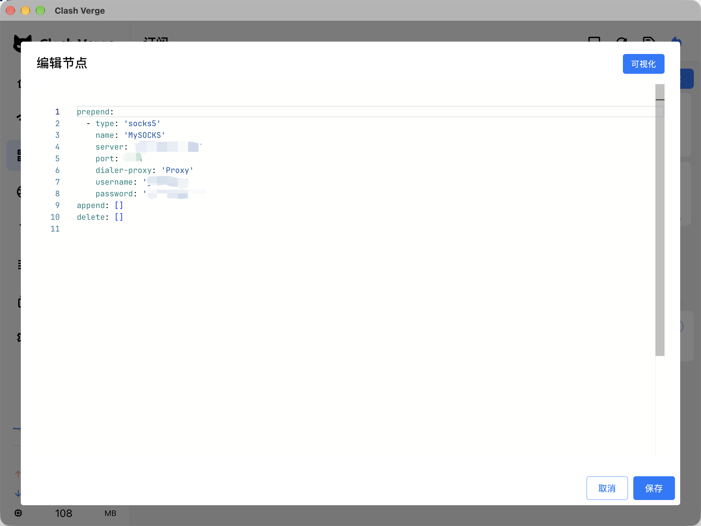
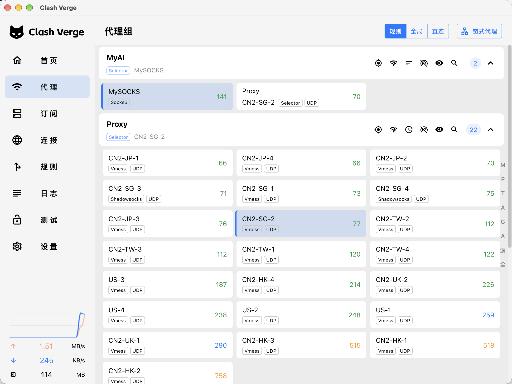
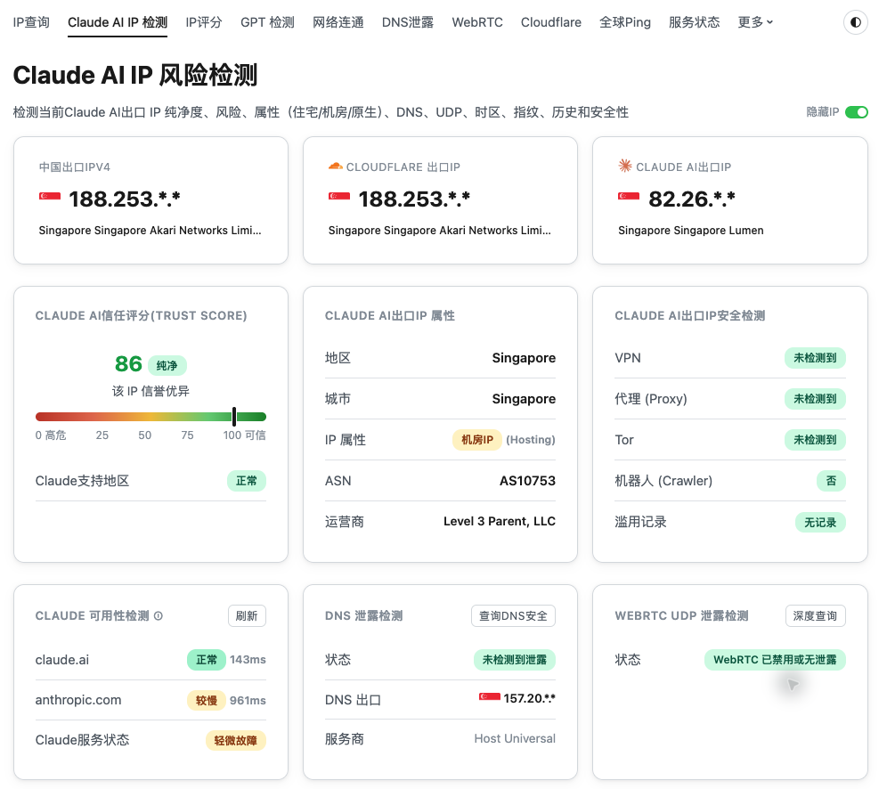

# Clash Chain Proxy (`clash-chain-proxy`)

为 **Clash Verge Rev** 选定订阅配置 SOCKS5 链式代理的 Agent Skill 与命令行配置工具。默认附带 Claude 分流规则，支持客户自行填写或配置 SOCKS5 连接信息、追加自定义分流规则、只读变更预览、扫描已配置订阅、自动备份与安全还原。

## 设计目的：它能解决什么问题？

在手动配置“机场中转 + 固定 IP 落地”的链式代理时，常见做法是把落地节点的 `dialer-proxy` 写死为某一个具体节点（例如 `香港-01`）。一旦该节点波动或被限速，就必须重新打开编辑器修改配置文件。

**本工具的核心目的，是让链式代理可以像普通代理一样“通过界面切换节点来动态切换链路”：**

1. **切换机场节点，链式前置跳自动同步切换**  
   `MyAI` 的 `dialer-proxy` 绑定的是订阅的**上游代理组**（如 `Proxy` Selector 组），而不是单个固定节点。当你在 Clash Verge Rev 的“代理”面板里直接切换机场节点（比如从 `香港-01` 切到 `CN2-SG-2`）时，链式代理的前置中转通道会**自动跟着切换**，无需再改任何配置。
2. **一键切换“走固定 IP”或“仅走机场”**  
   通过自动生成的 `MyIP` 选择组，你可以随时在 `MyAI`（机场中转 → 固定落地 IP）和上游代理组（直接走机场出口）之间一键切换，既能保证 Claude 等敏感服务拥有稳定的固定出口 IP，又能在落地代理异常时快速兜底切回。
3. **只改增量、零侵入多订阅复用**  
   所有配置均写入订阅的扩展文件（prepend / 脚本包装），不破坏原订阅结构；换新订阅或需要同时维护多个机场订阅时，可一键批量注入同样的分流规则与链式拓扑。

## 效果示意



| 1. 编辑节点填写落地代理 | 2. 代理组选择链路生效 | 3. Claude 出口 IP 验证 |
| :---: | :---: | :---: |
|  |  |  |

---

## 核心特性

- **标准链式代理拓扑**：自动为目标订阅注入 SOCKS5 节点 `MyAI`（设置 `dialer-proxy` 指向订阅首个代理组）以及 `select` 选择组 `MyIP`（可选 `MyAI` 或上游代理组），链路为：
  ```text
  设备 → 订阅上游代理组 → SOCKS5 节点 (MyAI) → 目标服务
  ```
- **内置分流规则**：默认在 `assets/claude-rules.yaml` 中附带 27 条 Claude / Anthropic 域名、IP-CIDR、进程名及出口检测页（`ip.net.coffee`）分流规则，保留订阅原有规则。
- **支持追加自定义规则**：可通过用户配置文件追加 `DOMAIN`、`DOMAIN-SUFFIX`、`DOMAIN-KEYWORD`、`IP-CIDR`、`IP-CIDR6`、`PROCESS-NAME` 规则（出口固定为 `MyIP`）。
- **防循环脚本包装**：保留原订阅扩展脚本 `main()` 逻辑，并在其后追加防循环包装器，从非 `MyIP` 代理组的显式 `proxies` 列表中过滤 `MyAI` 与 `MyIP`。
- **安全与可逆设计**：
  - 默认只读预览，明确传入 `--apply` 才会写入文件。
  - 每次实际修改前自动在 `<配置目录>/.claude-chain-backups/<备份编号>/` 创建备份及 `manifest.json`（含 SHA-256 校验），还原时若检测到后续人工修改会主动中止，防止覆盖。
  - 接管保护：遇到来源不明的同名 `MyAI` / `MyIP` 对象时自动停止，需确认并显式传入 `--adopt-existing` 才接管。
  - 扫描与预览过程不泄露服务器地址、端口、用户名、密码或订阅链接等敏感信息。

---

## 目录结构

```text
clash-chain-proxy/                # 仓库根目录（可直接作为 Skill 目录安装）
├── SKILL.md                      # Agent Skill 主指令与工作流定义
├── README.md                     # 项目说明文档
├── requirements.txt              # Python 依赖（PyYAML）
├── .gitignore                    # Git 忽略规则
├── agents/
│   └── openai.yaml               # Skill UI 元数据配置
├── assets/
│   ├── claude-rules.yaml         # 内置 Claude 分流规则集
│   └── user-config.example.yaml  # 用户配置文件模板
├── docs/
│   └── images/                   # 界面截图与结果示意图
│       ├── clash-edit-node-socks5.png      # 节点高级编辑填写截图
│       ├── clash-proxies-group-status.png  # 代理组状态截图
│       └── claude-ip-test-result.png       # 出口 IP 检测通过截图
├── scripts/
│   └── configure.py              # 核心配置、扫描、备份与还原 CLI 脚本
├── tools/
│   └── package.py                # 打包脚本（生成 dist/clash-chain-proxy.skill）
├── dist/
│   └── clash-chain-proxy.skill   # 可直接导入的 .skill 分发归档包
└── tests/
    ├── test_configure.py         # 配置逻辑与安全扫描单元测试
    └── test_package.py           # Skill 打包产物单元测试
```

---

## 安装与使用

### 环境要求

- Python 3
- `PyYAML`（可通过 `pip install -r requirements.txt` 安装）
- Clash Verge Rev（目标订阅需已在 Clash Verge Rev 中打开并保存过**节点、代理组、规则、脚本**四个扩展关联，脚本本身不直接改写 `profiles.yaml`）

### 方式一：作为 Agent Skill 使用

1. **直接导入打包文件**：使用 [`dist/clash-chain-proxy.skill`](dist/clash-chain-proxy.skill) 安装到支持 `.skill` 的 AI Agent 客户端。
2. **源码目录安装**：将本仓库直接克隆或软链接到你的 Skills 目录（例如 `~/.agents/skills/clash-chain-proxy` 或对应客户端的 skills 目录），Agent 会自动读取根目录下的 [`SKILL.md`](SKILL.md)。

### 方式二：免安装，用提示词驱动任意 Agent

如果不想在本地安装 Skill，只要你使用的 AI Agent 具备终端执行能力（如 Claude Code、Cursor、Codex、Antigravity 等），直接把下面这段提示词复制发给它，即可临时拉取并按规范完成配置：

```text
请帮我为本机的 Clash Verge Rev 配置 SOCKS5 链式代理（默认含 Claude 分流规则），或帮我向已有链式代理追加分流规则。我不想在本地永久安装 Skill，请你按以下方式临时加载并执行：

1. 将仓库浅克隆到临时目录（如已有则更新）：
   git clone --depth 1 https://github.com/forest0909/clash-chain-proxy.git /tmp/clash-chain-proxy
2. 完整阅读 `/tmp/clash-chain-proxy/SKILL.md`，在本次对话中严格按照该文档的规范、命令参数、交互步骤和安全限制执行所有操作。
3. 所有脚本调用均使用 `/tmp/clash-chain-proxy/scripts/configure.py`；先检查 Python 3 和 PyYAML 是否可用，若缺少依赖先征求我同意或使用虚拟环境，不要破坏系统 Python。
4. 严格遵守安全边界：
   - 首次配置先运行 `--list` 列出全部订阅编号让我选择；如果是追加规则，先运行 `--list-configured` 筛选已有链式代理的订阅。
   - 未经我确认不写入配置，不主动索取或输出我的 SOCKS5 账号密码、订阅链接，不擅自添加 `--adopt-existing`，不更改代理模式、DNS、TUN 或 `profiles.yaml`。
5. 全部配置并验证完成后，询问我是否删除 `/tmp/clash-chain-proxy` 临时目录。

现在请先拉取仓库并阅读 `SKILL.md`，然后开始第一步的只读扫描，把候选订阅列表发给我选择。
```

### 方式三：作为独立 CLI 工具运行

脚本默认自动探测常见操作系统下的 Clash Verge Rev 配置目录（`io.github.clash-verge-rev.clash-verge-rev`）：
- macOS：`~/Library/Application Support/io.github.clash-verge-rev.clash-verge-rev`
- Windows：`%APPDATA%\io.github.clash-verge-rev.clash-verge-rev`
- Linux：`$XDG_DATA_HOME/io.github.clash-verge-rev.clash-verge-rev` 或 `~/.local/share/io.github.clash-verge-rev.clash-verge-rev`

若未自动检测到唯一目录，可通过 `--dir "配置目录"` 手动指定包含 `profiles.yaml` 的目录。

#### 1. 查看订阅列表

```bash
# 列出所有订阅（uid、name、current）
python3 scripts/configure.py --list

# 只读扫描已配置 MyAI/MyIP 链式代理的订阅
python3 scripts/configure.py --list-configured
```

#### 2. 生成待填配置（推荐在 Clash 客户端手填连接信息）

```bash
# 仅预览
python3 scripts/configure.py --subscription "<UID或订阅名>" --prepare

# 确认写入并自动备份
python3 scripts/configure.py --subscription "<UID或订阅名>" --prepare --apply
```

写入后，在 Clash Verge Rev 中：
1. 进入左侧 **订阅**，右键目标订阅选择 **编辑节点** → 右上角 **高级**。
2. 在 `prepend` 中找到名为 `MyAI`（或截图所示示例）的节点，填入 `server`、`port`、`username`、`password`（无认证可留空后两项）并保存。
3. 重新点击激活该订阅，在代理页确认 `MyIP → MyAI`，并在上游代理组选择可用节点。

#### 3. 通过外部配置文件写入连接信息或追加规则

复制模板文件到**仓库外的个人目录**（请勿将真实凭证提交到仓库）：

```bash
cp assets/user-config.example.yaml ~/clash-chain-user-config.yaml
```

配置文件结构如下：

```yaml
connection:
  server: '203.0.113.10'
  port: 1080
  username: 'your-username'
  password: 'your-password'
custom_rules:
  - DOMAIN-SUFFIX,example.com,MyIP
  - DOMAIN,api.example.org,MyIP
  - PROCESS-NAME,ExampleApp,MyIP
  - IP-CIDR,192.0.2.0/24,MyIP,no-resolve
```

> 说明：`connection` 中的空字段表示**沿用现存 `MyAI` 节点中已有的值**，不会把客户手动填写的信息覆盖为空。

执行预览与写入：

```bash
# 仅预览变更（不修改文件）
python3 scripts/configure.py --subscription "<UID或订阅名>" --config ~/clash-chain-user-config.yaml

# 确认写入
python3 scripts/configure.py --subscription "<UID或订阅名>" --config ~/clash-chain-user-config.yaml --apply
```

#### 4. 备份与还原

每次使用 `--apply` 产生实质文件变更时，都会输出一个备份编号。还原前可先预览，再加 `--apply` 执行：

```bash
# 预览还原影响
python3 scripts/configure.py --restore "<备份编号>"

# 确认还原
python3 scripts/configure.py --restore "<备份编号>" --apply
```

#### 5. 出口验证

激活订阅后，在本机浏览器打开 `https://ip.net.coffee/claude/`，并在 Clash Verge Rev 连接记录中确认请求实际经过 `MyIP → MyAI`，且检测页面显示的出口 IP 为你配置的落地 SOCKS5 固定 IP。

---

## 开发、测试与打包

### 运行单元测试

```bash
python3 -m unittest discover -s tests -v
```

### 重新打包 `.skill` 产物

修改 Skill 相关文件（`SKILL.md`、`agents/`、`assets/`、`scripts/`）后，运行打包脚本重新生成 `dist/clash-chain-proxy.skill`：

```bash
python3 tools/package.py
```

打包脚本仅收录运行时所需的 Skill 核心文件，会自动排除 `README.md`、`docs/`、`tests/`、`tools/`、`dist/` 以及 `__pycache__` 等缓存文件。
